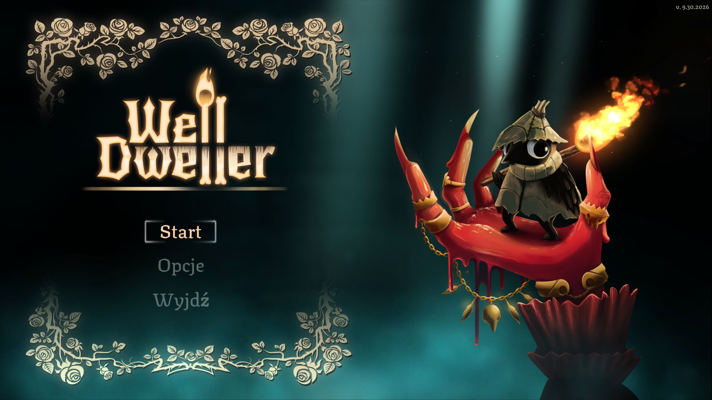
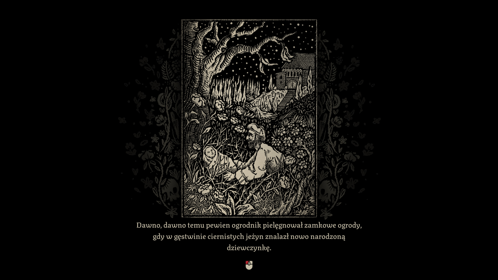
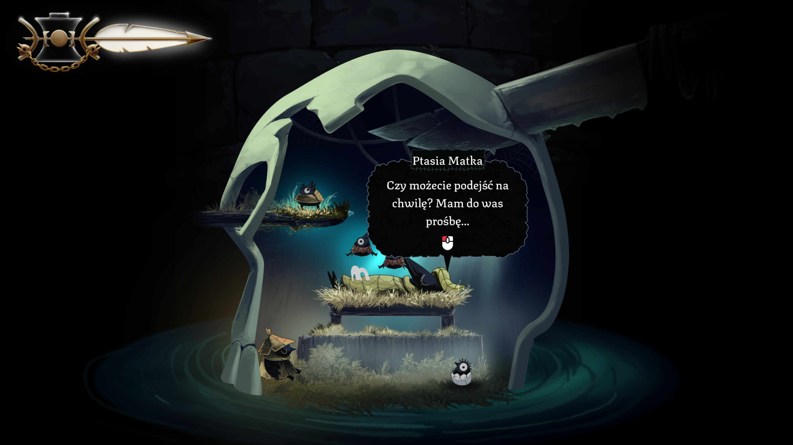
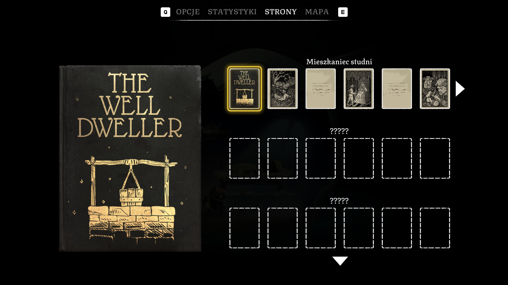
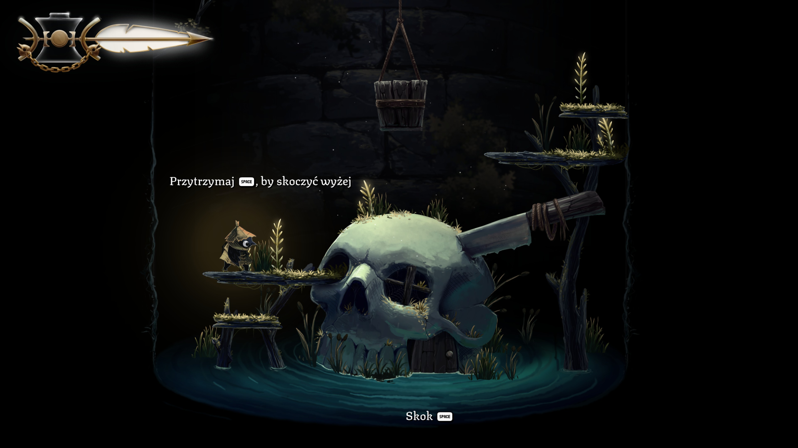
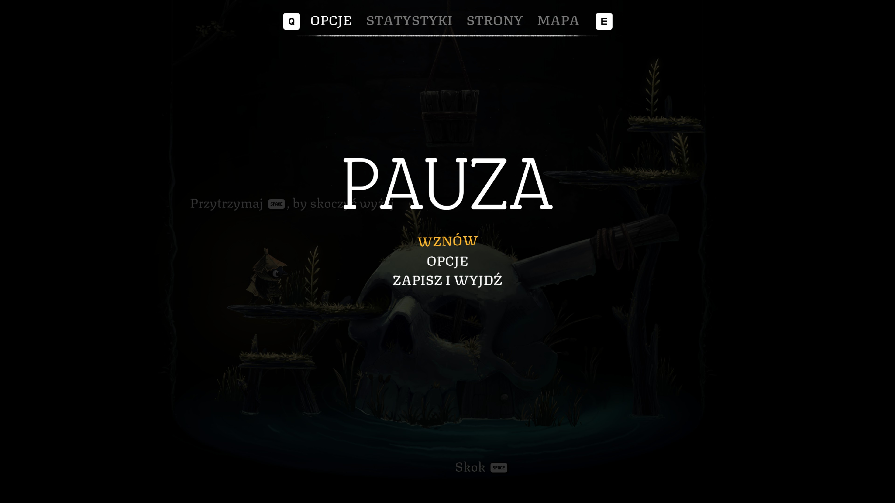

# Well Dweller — Spolszczenie PL

Fanowska polska lokalizacja Well Dweller 1.0.0.

## 📦 Aktualne wydanie

**v1.0.0**

➡️ [Pobierz najnowszą wersję](https://github.com/mariuszm22/Well-Dweller-Spolszczenie-PL/releases/tag/v1.0.0)

- [EXE — instalator automatyczny](https://github.com/mariuszm22/Well-Dweller-Spolszczenie-PL/releases/download/v1.0.0/marko22-Instalator-Well-Dweller-PL-1.0.0.exe)
- [ZIP — instalator i instrukcja w archiwum](https://github.com/mariuszm22/Well-Dweller-Spolszczenie-PL/releases/download/v1.0.0/Well_Dweller_PL_1.0.0.zip)
- [Suma SHA-256 instalatora](https://github.com/mariuszm22/Well-Dweller-Spolszczenie-PL/releases/download/v1.0.0/marko22-Instalator-Well-Dweller-PL-1.0.0.exe.sha256)

## Windows SmartScreen / instalator EXE

Windows może wyświetlić ostrzeżenie SmartScreen, ponieważ instalator EXE nie ma komercyjnego podpisu cyfrowego. Zgodność pobranego pliku można sprawdzić za pomocą dołączonej sumy SHA-256.

## 📷 Zrzuty ekranu

## 📋 Zawartość tłumaczenia

Obejmuje dialogi, podpowiedzi, nazwy miejsc, opisy wyposażenia, menu i wybrane napisy graficzne. Prace objęły 1 596 wpisów lokalizacyjnych oraz dopracowanie polskich znaków w nagłówkach.

**Zgodność:** Well Dweller na Windows w Steam, BuildID `25633433`. Wymagana jest własna kopia gry.

## ⚙️ Instalacja

1. Pobierz `marko22-Instalator-Well-Dweller-PL-1.0.0.exe` z plików wydania i zamknij grę.
2. Uruchom instalator i zatwierdź wykryty katalog Steam lub wskaż katalog Well Dweller ręcznie.
3. Wybierz **Zainstaluj polską lokalizację** i potwierdź. Uruchom grę ze Steam. Jeśli kreator poprosi o ręczny wybór języka, użyj **Opcje → Rozgrywka → Język → POLSKI**.

## 🗑️ Deinstalacja

Uruchom ten sam instalator przy zamkniętej grze i wybierz **Przywróć oryginalne pliki**. Zachowaj kopię zapasową. [Pełna instrukcja instalacji i aktualizacji](INSTALACJA.md).

## 🐞 Zgłaszanie błędów

Dołącz zrzut ekranu i krótki opis miejsca, w którym występuje problem. [GitHub Issues](https://github.com/mariuszm22/Well-Dweller-Spolszczenie-PL/issues)

## ⚠️ Informacja

[Strona projektu](https://marko22.pl/well-dweller) · [Kulisy spolszczenia](https://marko22.pl/assets/downloads/well-dweller/Kulisy_spolszczenia_Well_Dweller.html) · [Well Dweller w Steam](https://store.steampowered.com/app/3699590/)

Autor spolszczenia i redakcja: **marko22**. Projekt fanowski. Prawa do gry i jej grafiki należą do ich właścicieli.

## 🎮 Miłej gry!

Życzę udanej zabawy w Well Dweller!
